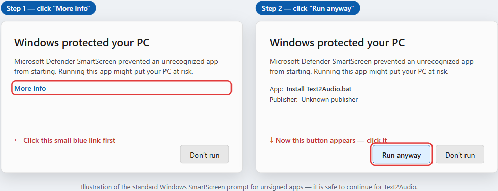

# Installing Text2Audio — the friendly guide

This is the plain-English guide for getting Text2Audio running on **Windows**, with
no command-line knowledge needed. If you're comfortable with a terminal, the
[README](README.md) has the developer setup and the `pip` install instead.

---

## 1. Download

1. Go to the project page: <https://github.com/mooja77/Text2Audio>
2. Click the green **Code** button → **Download ZIP**
   (or use this direct link: **[Download ZIP](https://github.com/mooja77/Text2Audio/archive/refs/heads/master.zip)**).
3. Find the downloaded `Text2Audio-master.zip`, right-click it → **Extract All…**, and
   pick a sensible spot like your **Desktop** or **Documents** folder.

You'll end up with a folder called `Text2Audio-master` (or similar) containing
`Install Text2Audio.bat`, `Start Text2Audio.bat`, and the rest of the app.

---

## 2. Install (one time)

Double-click **`Install Text2Audio.bat`**.

A black window opens and walks through the setup automatically:

- Checks that Python 3.10-3.12 is installed (it tries to fetch it with winget if not, and tells you what to do if that fails).
- Creates a private workspace for the app (a `.venv` folder) so it doesn't touch the
  rest of your system.
- Checks your **NVIDIA graphics card**, then checks CUDA and free GPU memory again
  after the dependencies are installed. It saves the result without replacing your
  other settings. If the Studio voice cannot use the GPU, the fast Kokoro voices
  still work on your processor.
- Installs the app's dependencies, plus **ffmpeg** and **espeak-ng** (the tools that
  build the audiobook file and help pronounce words).
- Downloads and verifies the pinned models, with the current file, MB and percentage
  shown as it works. All 15 English Kokoro voices are included. Chatterbox is added
  when the hardware check finds a usable GPU with enough free memory.
- Installs and checks the English language package, then verifies offline readiness.
- Adds a **Text2Audio** shortcut to your Desktop after setup succeeds.

This first install downloads a fair amount and can take several minutes. Let it run
until you see the green **"Done!"** message, then close the window.

The sourced model manifests contain about **0.34 GB** for Kokoro and an additional
**3.2 GB** for Chatterbox. Dependencies need more disk space. The installer checks
space before downloading. If setup stops, run the same installer again: completed,
verified files are reused and a retained partial download can resume. Your other
settings are preserved. A damaged model file or English language package is repaired.

The window prints a quoted **Log file** path at startup, on failure and on completion.
The usual installer log is `%LOCALAPPDATA%\Text2Audio\logs\install.log`; it falls
back to a temporary folder if necessary. The printed path is the one actually used.

### Step 0: install Python 3.12 first (if you don't have it)

Text2Audio needs a real copy of **Python 3.10, 3.11 or 3.12** (3.12 recommended; 3.13 and newer are not supported yet).

1. Download Python 3.12 from <https://www.python.org/downloads/windows/> and run it.
2. On the first screen, **tick "Add python.exe to PATH"**, then click **Install Now**.
   (Or, in a terminal: `winget install Python.Python.3.12`.)
3. Close any open black windows, then double-click **`Install Text2Audio.bat`**.

If you see *"Python was not found; run without arguments to install from the Microsoft Store"*, that is only a Windows placeholder: Python is not installed yet. Do the steps above. The installer now checks for Python first and tells you if it is missing.

### "Windows protected your PC" (SmartScreen)

Because these `.bat` files aren't signed by a big company, Windows may show a blue
**"Windows protected your PC"** box. This is normal for small open-source tools.

- Click **More info**, then **Run anyway** (see the picture below).
- The `.bat` files are short, plain-text scripts — you're welcome to open them in
  Notepad first and read exactly what they do.

### If something needs admin permission

The installer uses Windows' built-in **winget** to fetch Python/ffmpeg/espeak-ng. If a
step asks for permission or fails because you're not an administrator, right-click
`Install Text2Audio.bat` and choose **Run as administrator**, then try again. The
installer is safe to re-run — it skips anything that's already done.

---

## 3. Run

Double-click **`Text2Audio`** on your Desktop (or `Start Text2Audio.bat` in the
folder).

- A small black window opens and stays open — that's the app running. **Leave it open**
  while you use Text2Audio; closing it stops the app.
- Your web browser opens automatically to the Text2Audio Studio.
- Drag in your manuscript (`.txt`, Markdown, DOCX, EPUB or text-based PDF), review the
  detected chapters, optionally edit the prepared text/add cover art, pick a voice,
  and click **Generate**.

When you're finished, just close the black window.

> Models and the English language package are prepared by the installer. The
> checklist at the top of Studio confirms readiness. If it reports missing or
> damaged files, run the installer again before rendering.

---

## Where your files live

Your app data defaults to the Text2Audio folder you unzipped:

- **`library/`** — your finished audiobooks (`.m4b` files with chapter markers).
- **`voices/`** — any voices you've cloned.
- **`output/`** — working/intermediate audio.
- **`data/chunk-cache/`** — reusable local narration chunks that make unchanged
  rerenders faster. Delete this folder while Text2Audio is stopped to clear the cache.
- **`data/settings.json`** — saved hardware results alongside your existing settings.

Models live in your per-user Hugging Face cache. An existing `HF_HUB_CACHE` or
`HF_HOME` setting is honoured by both installer and runtime. Otherwise the cache
is `.cache\huggingface\hub` under your user folder. Installer and launcher logs
normally live under `%LOCALAPPDATA%\Text2Audio\logs`, outside the app folder.

Nothing is uploaded anywhere — your text and audio never leave your computer.

---

## The studio voice and voice cloning

The installer sets up both voice engines:

- **Studio Narrator** (Chatterbox by Resemble AI). This is the best-sounding voice and
  the default when the hardware check finds usable NVIDIA CUDA and enough free GPU
  memory. The current policy requires at least 5 GB free, based on the recorded
  Chatterbox benchmark and a safety margin. It is much slower than the fast
  voices: on our test PC a book took about one and a half times as long to make as it
  lasts (a 10-hour book takes about 15 hours).
- **Fast voices** (Kokoro). Fifteen British and American voices that work on any PC.
  These are the default when Studio is unavailable. The app explains whether a
  GPU check, available memory or an explicit CPU setting is responsible.

If Kokoro runs out of CUDA memory and falls back to the processor, it stays there until you restart
Text2Audio. If a Studio job runs out of GPU memory, it stops with an explanation;
choose one of the Kokoro narrators for the next job. Cloning stays unavailable on
the CPU route. An optional `T2A_DOWNLOAD_CHATTERBOX=1` prefetch only downloads files;
it does not make Studio or cloning available on a CPU.

To clone a voice, go to **Voices → Clone a voice**. Tick the box once to confirm you
have the right to clone the voice. Then give it a name and upload 10–30 seconds of
clean speech from one person. Cloned voices use the studio engine, so they need a
graphics card too.

You may sell audiobooks made with the studio voice or with a clone of a voice you have
the right to use: both engines are open source and allow commercial use. Studio and
cloned audio carry an inaudible watermark that marks them as AI-generated.

Already using Text2Audio 1.4 or earlier? Run **Install Text2Audio.bat** again to add
the new engine. It replaces the optional F5-TTS cloning engine, which you can remove
with `.\.venv\Scripts\python.exe -m pip uninstall f5-tts`.

> ⚠️ **Only clone voices you have the right to use** — your own voice, voices you have
> permission to clone, or public-domain recordings. Don't impersonate people or create
> deceptive audio.

---

## Uninstalling

Text2Audio doesn't scatter files around your system. To remove it:

1. **Delete the Text2Audio folder** you unzipped. That removes the app, its private
   `.venv` workspace, and your library/voices (back up anything in `library/` first if
   you want to keep your audiobooks).
2. **Delete the Desktop shortcut** ("Text2Audio").
3. *(Optional)* The installer may have added **Python**, **ffmpeg**, and **espeak-ng**
   via winget. If you don't want those anymore, remove them from
   **Settings → Apps → Installed apps**. (Leave them if other programs use them.)
4. *(Optional)* The active model cache contains `models--hexgrad--Kokoro-82M` and
   `models--ResembleAI--chatterbox`. Remove those specific folders only when no
   other app needs the models. Your active cache may follow an existing
   `HF_HUB_CACHE` or `HF_HOME` setting.

---

## Troubleshooting

**"Text2Audio is not installed yet."**
You double-clicked **Start** before **Install** finished. Run
`Install Text2Audio.bat` first and wait for the green "Done!" message.

**The browser didn't open.**
The launcher opens the browser after its own server is healthy. Read any message
in the black window and its quoted log path. If the app is running, open
<http://127.0.0.1:8765> manually. The app listens on your own computer only.

**"Port 8765 is already in use."**
Another Text2Audio window or another program is using that port. Close that window
or program, then start Text2Audio again. The launcher does not stop other programs.
For technical users, `T2A_PORT` selects another loopback port and the browser URL
uses the same port.

**Setup stopped or the voice models are missing.**
Double-click `Install Text2Audio.bat` again. Keep the printed log path if you need
to diagnose a failed dependency or download. A download resumes when the server
accepts its retained byte range; if that is unavailable, the file is restarted
and verified. Finished, valid files are kept.

**The black window flashes and disappears.**
Run the `.bat` from a PowerShell window so you can read the error: Shift-right-click in
the folder → **Open PowerShell window here**, then type `.\"Start Text2Audio.bat"` and
press Enter. Copy any error message into a
[GitHub issue](https://github.com/mooja77/Text2Audio/issues).

**Generation is very slow.**
You're probably on the CPU build (no NVIDIA GPU detected). It still works, just slowly —
try a shorter chapter first, or run on a machine with an NVIDIA graphics card.

**Words are mispronounced.**
Use the **Pronunciations** tab in the app to add a fix for tricky names, then re-generate.

**Still stuck?**
Open an issue at <https://github.com/mooja77/Text2Audio/issues> with what you tried and
any error text — we're happy to help.
