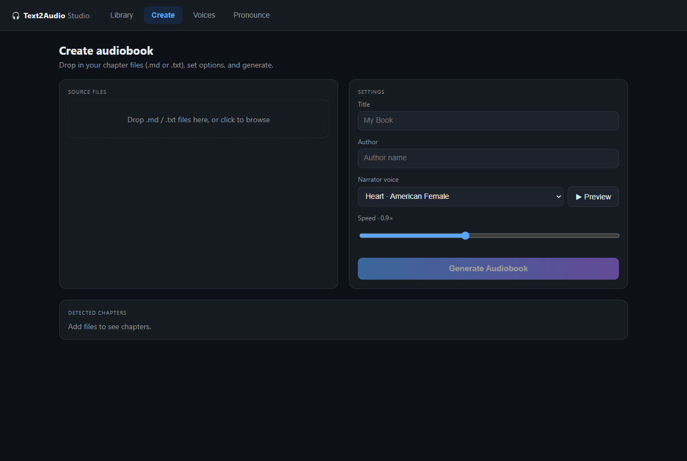
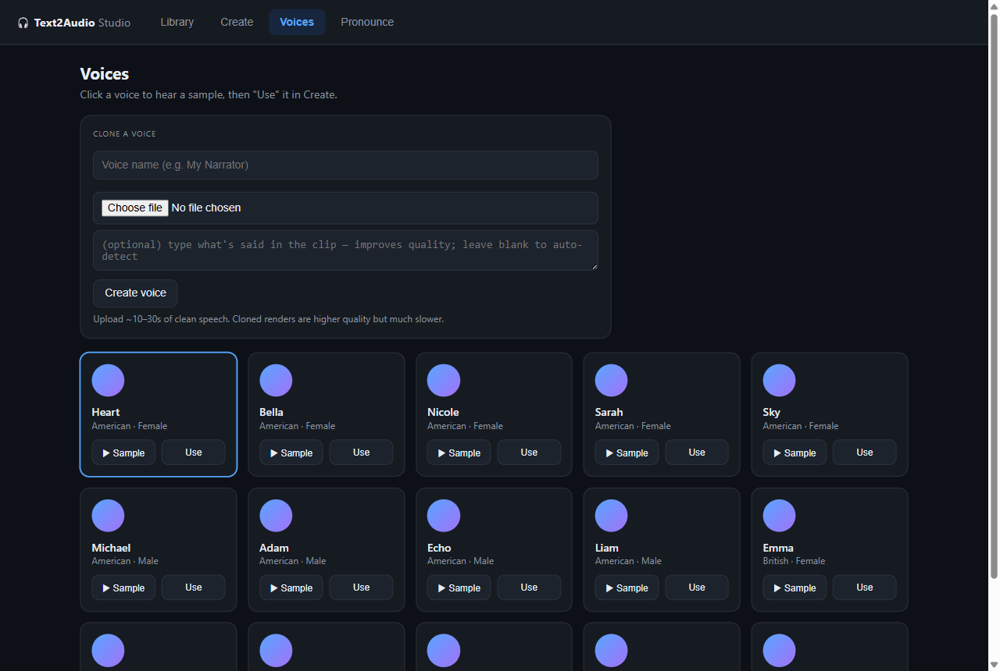
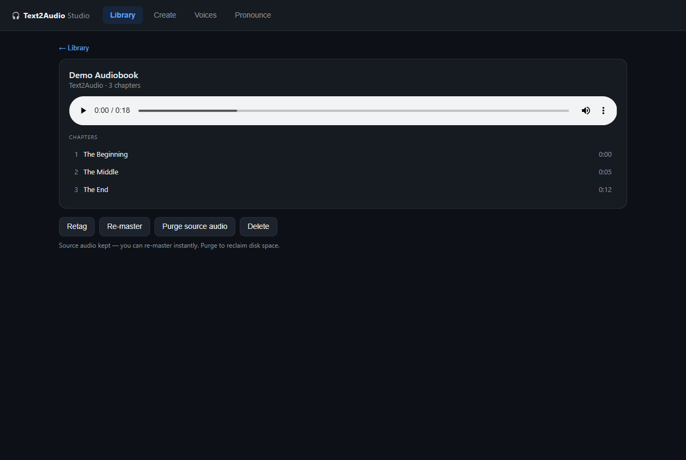
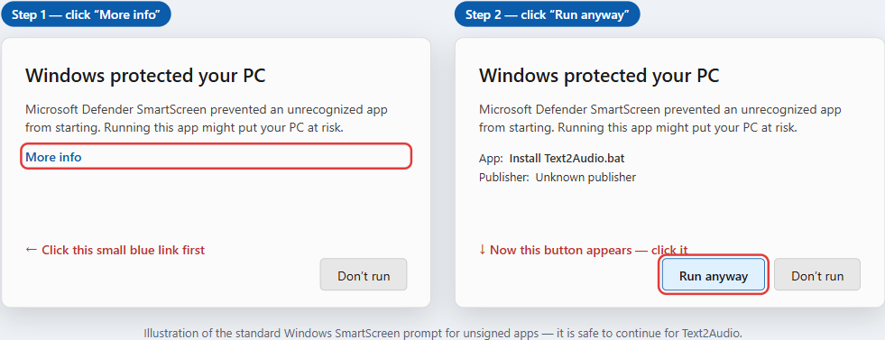

# 🎧 Text2Audio

**Turn a book into a natural-sounding, chaptered audiobook — for free, fully on your own machine.**

[](https://github.com/mooja77/Text2Audio/actions/workflows/ci.yml)
[](LICENSE)

🔊 **[Hear a sample](assets/sample.mp3)** — a short clip narrated by Text2Audio.

Text2Audio is a local, open-source audiobook studio. Drop in your manuscript
(`.txt`, Markdown, DOCX, EPUB or text-based PDF), pick a narrator, and get a mastered `.m4b` audiobook with
chapter markers — no cloud, no accounts, no per-use cost. It can even **clone a
voice** from a short audio sample.

It runs entirely offline on your own machine using open-source text-to-speech
models: **Chatterbox** (Resemble AI, MIT) for the studio narrator voice and voice
cloning, and **Kokoro-82M** (Apache-2.0) for fast voices on any PC. Both allow
commercial use, so you may sell the audiobooks you make.

## Screenshots

| Create | Voices &amp; cloning | In-app player |
|:---:|:---:|:---:|
|  |  |  |

---

## 🚀 Quick start (no terminal needed — Windows)

Don't want to touch a command line? On Windows you can be up and running in three steps:

1. **[Download the project as a ZIP](https://github.com/mooja77/Text2Audio/archive/refs/heads/master.zip)** and unzip it somewhere you want to keep the app.
2. Double-click **`Install Text2Audio.bat`**. It finds a supported Python (3.10–3.12), tries winget if Python is missing, and explains manual installation if needed. It installs the dependencies, audio tools, pinned voice models and English language package. Wait for **Done!**; the models are prepared during installation.
3. Double-click **`Start Text2Audio`** (the installer also adds a shortcut to your Desktop). Your browser opens the Studio — start making audiobooks. Keep the little black window open while you use the app; closing it stops Text2Audio.

Inside Studio, the optional five-step beginner guide is resumable and dismissible:

1. Add `.txt`/Markdown or choose **Use safe example**.
2. Check the detected chapters.
3. Choose and preview a narrator.
4. Generate the audiobook.
5. Listen in **Library**.

Experienced users can select **Skip guide** and work directly. If only the browser
page refreshes during a render, Studio reconnects to the active job. A finished `.m4b`
plus its local manifest is the durable first useful result.

- **[Searchable help and privacy guide](docs/HELP.md)**
- **[Captioned short walkthrough with matching steps](docs/WALKTHROUGH.md)**
- **[Ask for help](https://github.com/mooja77/Text2Audio/issues/new?template=bug_report.yml)**
- **[Request a feature](https://github.com/mooja77/Text2Audio/issues/new?template=feature_request.yml)**

> The installer shows the current model file, downloaded MB and percentage. A stopped download can resume when you run the installer again. Verified files and your existing settings are kept. Setup checks offline readiness before creating the Desktop shortcut.
>
> ⚠️ Windows may show a blue **"Windows protected your PC"** SmartScreen box on the `.bat` files — click **More info → Run anyway** (see below). The scripts are plain text you can open and read first. A full walkthrough, voice-cloning setup, and troubleshooting live in **[INSTALL.md](INSTALL.md)**.



### Install with pip (any OS, for technical users)

```bash
pip install git+https://github.com/mooja77/Text2Audio
```

This installs both engines (Chatterbox and Kokoro). You'll still need **ffmpeg** and **espeak-ng** installed on your system, and — for GPU
speed — a CUDA build of PyTorch (`pip` pulls the CPU build by default). See
[Setup](#setup) below for model and language-package preparation before starting the app.

---

## Features

- 📖 **Book → audiobook** — `.txt`, Markdown, DOCX, EPUB or text-based PDF in,
  chaptered `.m4b` out (plays in
  Apple Books, Smart AudioBook Player, BookPlayer, etc. with chapter navigation).
- 🖥️ **Studio web UI** — drag-and-drop multi-file import, a voice gallery, live
  per-chapter progress, a built-in chapter player, and a library of your renders.
- 🎚️ **Mastered audio** — 128 kbps AAC, loudness-normalized (~−19 LUFS), high-pass
  filtered, with natural sentence/paragraph pacing. Re-master any book instantly
  (no re-synthesis).
- 🗣️ **Reads text correctly** — expands numbers/abbreviations and an editable
  **pronunciation dictionary** fixes tricky names.
- 🎙️ **Studio narrator voice** — Chatterbox (Resemble AI, MIT), the best open-source
  model in our November 2026 bake-off, is available when the hardware check finds
  usable NVIDIA CUDA and enough free GPU memory. Kokoro's 15 voices stay as the fast option for any PC.
- 🎤 **Voice cloning** — upload ~10–30 s of speech and narrate in that voice, via
  Chatterbox (runs in an isolated worker). The code and weights are MIT, so cloned
  audiobooks can be sold. The app asks you once to confirm you have the right to
  clone the voice. Chatterbox audio carries an inaudible watermark that marks it
  as AI-generated.
- 🔒 **100% local & free** — your text and audio never leave your machine. The
  server binds `127.0.0.1` only, and once the model is downloaded a render opens
  no network connections.
- ♿ **Accessible** — keyboard-only use, visible focus, screen-reader
  announcements for progress and errors; checked against WCAG 2.2 AA with axe-core.
- 🧭 **Plain-language help** — a first-run checklist (audio tool, pronunciation
  tool, voice model, disk space) and errors written for people, not programmers.
- 📜 **Licences in the app** — Help lists every model and library with its
  licence, from the verified record in [`docs/LICENSES.md`](docs/LICENSES.md).
- ✏️ **Review before rendering** — edit prepared text and chapter markers in Studio.
- 🖼️ **Cover artwork** — embed JPEG, PNG or WebP art in the finished M4B.
- 📦 **Flexible export** — personal M4B, lossless chapter WAV ZIP, or ACX-review
  chapter MP3 ZIP with a machine-readable quality report.
- ⏹️ **Long-render controls** — chunk-level progress, cancellation and browser refresh recovery.

## Requirements

- Windows (developed/tested on Windows 11), Linux, or macOS. Text2Audio automatically
  selects NVIDIA CUDA, Apple MPS, or CPU. Set `T2A_DEVICE` to `cuda`, `mps`, or
  `cpu` to override detection.
- **For the studio voice and cloning:** an NVIDIA graphics card with about 5 GB of
  free memory (Chatterbox peaked at 4.5 GB in our tests), plus about 3.5 GB of disk
  for the model. See the release notes for
  the speed we measured; Chatterbox is far slower than Kokoro, and on a CPU it is
  too slow for whole books.
- **For the fast Kokoro voices:** any PC. Kokoro ran about 28 times faster than real
  time on the test PC's RTX 3090 and about 3 times faster than real time on its CPU.
- **Python 3.10–3.12**
- **[ffmpeg](https://www.gyan.dev/ffmpeg/builds/)** on your `PATH` (provides
  `ffmpeg` and `ffprobe`).
- **[espeak-ng](https://github.com/espeak-ng/espeak-ng/releases)** (Windows `.msi`)
  — phonemizer backend for Kokoro.

## Setup

> Non-technical user on Windows? Skip this — use the
> [Quick start](#-quick-start-no-terminal-needed--windows) above and
> [INSTALL.md](INSTALL.md) instead. The steps below are the manual developer setup.

```powershell
git clone https://github.com/mooja77/Text2Audio.git
cd Text2Audio
python -m venv .venv
.\.venv\Scripts\Activate.ps1
# Install a CUDA build of PyTorch first (pick the index for your CUDA version):
pip install --index-url https://download.pytorch.org/whl/cu124 torch==2.6.0 torchaudio==2.6.0
pip install -r requirements.txt
```

If espeak-ng isn't auto-detected, point to it:

```powershell
setx PHONEMIZER_ESPEAK_LIBRARY "C:\Program Files\eSpeak NG\libespeak-ng.dll"
setx PHONEMIZER_ESPEAK_PATH "C:\Program Files\eSpeak NG\espeak-ng.exe"
```

### Linux / macOS

The project is plain Python and cross-platform. The commands are the same, except:

- Activate the venv with `source .venv/bin/activate`.
- Install ffmpeg and espeak-ng from your package manager:
  - Debian/Ubuntu: `sudo apt install ffmpeg espeak-ng`
  - macOS (Homebrew): `brew install ffmpeg espeak-ng`
- Where this README shows `.\.venv\Scripts\python.exe`, use `.venv/bin/python`.
- Pick the PyTorch index for your platform/accelerator from
  [pytorch.org](https://pytorch.org/get-started/locally/) (e.g. ROCm on Linux, or
  the default CPU/MPS build on macOS — note Kokoro and Chatterbox are much faster on CUDA).
  Chatterbox pins `torch==2.6.0` and `torchaudio==2.6.0`, so install those
  versions from your index first.

### Prepare models for a manual or pip installation

The Windows double-click installer performs this preparation for you. For a manual
installation, run these commands in the environment where Text2Audio is installed:

```powershell
python -m backend.hardware --post-install
python -m backend.model_download
python -m pip install "https://github.com/explosion/spacy-models/releases/download/en_core_web_sm-3.8.0/en_core_web_sm-3.8.0-py3-none-any.whl#sha256=1932429db727d4bff3deed6b34cfc05df17794f4a52eeb26cf8928f7c1a0fb85"
python -c "import spacy; spacy.load('en_core_web_sm')"
```

After preparation, start a pip installation with `text2audio`. For a source
checkout, use the [Run](#run) command below.

The downloader always prepares all 15 English Kokoro voices. It also prepares
Chatterbox when the saved hardware check permits it. `T2A_DOWNLOAD_CHATTERBOX=1`
requests an optional prefetch; it does not enable Studio on a CPU-only runtime.
The language package must be version 3.8.0 and load successfully. The Windows
installer repairs a damaged copy of that same version without replacing dependencies.

## Run

```powershell
.\.venv\Scripts\python.exe server.py
```

Your browser opens the Studio. **Create** tab: drag in a supported manuscript
(Markdown is auto-cleaned), set title/voice/speed, and **Generate** — live
per-chapter progress streams as it renders. **Voices**: audition narrators or
clone one. **Library**: every finished audiobook with an in-app chapter player,
re-master, and delete.

The normal M4B preset is intended for personal listening. The **ACX-review** export
is a technical starting point, not a guarantee of distributor acceptance: add required
credits and room tone, listen to every chapter, and validate it with the distributor.

> A classic single-screen UI is also available. Install its optional dependency
> with `pip install "text2audio[classic]"`, then run `python app.py` from a source checkout.

### Unknown narrator voices

If a render request names a voice that is neither a built-in preset nor a stored
cloned voice (for example, the clone was deleted in another tab), the API
answers **HTTP 422** with
`{"detail": "unknown voice", "error": "unknown voice", "voice": "<id>"}` and
creates nothing in your library. Voice preview (`/api/voice-preview`) gives the
same answer. Before v1.4.0 both endpoints answered HTTP 400. Voice lookup now lives in one place
(`backend/render.py::resolve_synthesizer`). No new models or libraries were
added, and nothing here touches the network.

### Offline readiness and CPU fallback

Installation downloads pinned model files with a disk-space check, byte progress,
resumable partial files and digest verification. Runtime loads those same local
paths. Full offline readiness requires all English Kokoro voices and the English
language package; a GPU runtime also requires the pinned Chatterbox files. An
optional Chatterbox prefetch never blocks CPU readiness.

The app sets `HF_HUB_OFFLINE` and `TRANSFORMERS_OFFLINE` before model-library imports
once the required files are ready. Existing explicit offline settings are respected.
Missing or damaged files direct you back to the installer instead of downloading
unseen files during a render. The cache follows `HF_HUB_CACHE`, then
`HF_HOME` plus `/hub`, then the usual per-user Hugging Face cache.

The hardware check saves its result in `data/settings.json` for a source checkout,
preserving other settings. Runtime checks available memory again. A CPU override
(`T2A_DEVICE=cpu`) takes priority: Kokoro/Heart becomes the default and Studio and
cloning are disabled with an explanation. After a CUDA out-of-memory error,
Kokoro's CPU fallback is remembered until restart. A late Studio refusal or GPU memory
failure stops that Studio job with guidance; choose a Kokoro voice to continue.
`GET /api/health` reports `device`, `engines`, `defaultVoice` and the availability reasons.

### First-run checklist and error messages

Studio shows a short setup checklist at the top of the page covering ffmpeg,
espeak-ng, the voice-model download and free disk space (2 GB). Each item that
needs attention says what to do. The same list is returned by `GET /api/health`
as `checklist` (with `ready` true when every item passes). Errors in the UI are
shown in plain language, never as raw stack traces.

### Chapter markers

For one-file-per-chapter imports, each file's first `# Heading` becomes the
chapter title. For a single `.txt`, put a marker line before each chapter:

```
## Chapter One
Once upon a time...

## Chapter Two
...
```

If there are no markers, it auto-detects `Chapter N` / ALL-CAPS headings, else
treats the whole text as one chapter.

## Studio voice and voice cloning

Both use **Chatterbox** (Resemble AI; MIT code and MIT weights), installed with the
app. It runs in an isolated worker process, so the server stays light and Kokoro
never shares a process with it. Installation prepares its pinned weights when a
usable GPU is available. Their sourced manifest size is about 3.2 GB, in addition
to the Kokoro models. Runtime uses the prepared local files.

In **Voices → Clone a voice**, tick the box once to confirm you have the right to
clone the voice. Then name the voice and upload 10–30 s of clean speech from one
person (Chatterbox listens to the first 10 s). The cloned voice appears alongside the
built-ins and in the Create dropdown. Use **▶ Sample** to audition first.

Every Chatterbox recording carries Resemble AI's inaudible Perth watermark, which
marks it as AI-generated. It does not limit what you can do with the audio.

Books cloned with F5-TTS before 1.5.0 keep their "non-commercial" mark in the
library. Re-render them with 1.5 to use Chatterbox instead.

### ⚠️ Responsible use

Only clone voices you have the right to use — **your own voice, voices you have
explicit permission to clone, or public-domain recordings**. Do not impersonate
people or create deceptive audio. You are responsible for how you use this tool.

## Tests

The suite runs **without a GPU** (the TTS engines are mocked):

Developer tests require **Node.js on PATH** as well as pytest: the suite runs the
real JavaScript UI behaviour checks. Node is only a test prerequisite; the installed
Python app runs without it.

```powershell
pytest -q
```

GPU model tests are opt-in: `$env:RUN_KOKORO=1; pytest tests/test_synth.py` and
`$env:RUN_CHATTERBOX=1; pytest tests/test_clone_synth.py`.

## How it works

```
book (.txt/.md) → ingest (clean markdown) → normalize (numbers/abbr/pronunciation)
   → chunk (sentence/paragraph) → synthesize (Kokoro, or Chatterbox in its worker) → assemble (ffmpeg:
   chapters + loudness master) → .m4b in your library/
```

Project layout: `pipeline/` (text→audio), `backend/` (library, jobs, render,
voices, pronunciations), `server.py` (FastAPI + web API), `web/` (vanilla-JS UI).

## Contributing

See [CONTRIBUTING.md](CONTRIBUTING.md). Issues and PRs welcome.

## License

Text2Audio's code is **MIT** (see [LICENSE](LICENSE)). The TTS **models** it
downloads have their own licences: Chatterbox is MIT and Kokoro is Apache-2.0,
and both allow commercial use. See [THIRD_PARTY_LICENSES.md](THIRD_PARTY_LICENSES.md)
and the verified record with sources in [docs/LICENSES.md](docs/LICENSES.md).

## Acknowledgements

- [Chatterbox](https://github.com/resemble-ai/chatterbox) by Resemble AI — studio narrator voice and voice cloning
- [Kokoro-82M](https://huggingface.co/hexgrad/Kokoro-82M) — fast narrator voices
- ffmpeg, espeak-ng, FastAPI, and the wider open-source ecosystem
